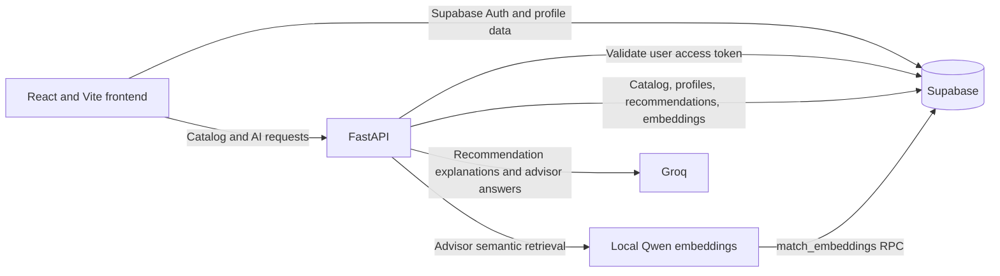

# EduBridge V2

EduBridge V2 helps students explore universities and degree programs, compare options against their academic profile and preferences, and get AI-assisted guidance. Students can browse the catalog without signing in; a completed student profile unlocks personalized recommendations and dashboard tools.

## What it does

- Browse the university catalog and view university details, programs, and program requirements.
- Create an account, sign in, and complete personal and academic profile information.
- Generate program recommendations using profile-based eligibility filtering and ranking, with AI-generated explanations and fit labels.
- Review estimated minimum, maximum, and average semester fees for the generated recommendations.
- Browse active scholarships.
- Run a temporary “What If” comparison by changing selected academic or preference values without changing the saved profile or persisting the simulated recommendations.
- Ask the AI Advisor questions. The advisor assembles contextual evidence using semantic and structured retrieval before generating a response.

## Technology

| Area | Technologies |
| --- | --- |
| Frontend | React 19, Vite 7, React Router 7, Zustand, Tailwind CSS via the Vite plugin, Supabase JavaScript client |
| Backend | Python, FastAPI, Uvicorn, Pydantic Settings, Supabase Python client |
| Database and authentication | Supabase (Postgres and Supabase Auth); the frontend also reads and writes student profile data and reads scholarships through Supabase |
| AI | Groq chat completions for recommendation explanations and advisor answers; Sentence Transformers with the configured Qwen embedding model for local embeddings; a Hugging Face embedding provider is also present in the backend |

## Architecture



The frontend uses Supabase Auth for sessions and reads or writes student profile records and active scholarships through the Supabase client. It calls the FastAPI backend for the university catalog, recommendations, What If simulations, and Advisor chat. Protected backend routes validate the caller’s Supabase access token. The backend uses a server-side Supabase client for catalog and recommendation data.

Recommendation generation loads the student profile and programs, filters and ranks eligible programs, asks Groq for explanatory reasoning, and saves the resulting recommendations. What If follows the same filtering and ranking approach against a temporary profile copy and does not save those results. The Advisor uses a query planner to choose semantic, structured, or hybrid retrieval; retrieved evidence is passed to Groq to compose an answer.

## Repository layout

```text
backend/
  app/
    api/           FastAPI route handlers
    core/          Backend settings
    db/            Supabase clients and authentication dependencies
    repositories/  Supabase data access
    schemas/       Request and response models
    services/      Recommendations, retrieval, AI, and advisor logic
  tests/           Backend tests
  requirements.txt
  .env.example
frontend/
  src/
    components/    Pages and UI components
    pages/         Catalog and university pages
    store/         Zustand state
    supabase/      Supabase and API services
  package.json
```

## Prerequisites

- Node.js and npm for the Vite frontend.
- Python 3.10 or newer for the backend.
- A Supabase project configured with the tables and database function described below.
- A Groq API key and model identifier for AI-generated responses.
- The configured embedding model available locally for semantic search and indexing. The backend loads the local Sentence Transformers provider on those paths.

## Local setup

### Backend

In PowerShell:

```powershell
cd backend
py -m venv .venv
.\.venv\Scripts\Activate.ps1
python -m pip install -r requirements.txt
Copy-Item .env.example .env
```

Fill in the backend values in `backend/.env` (see [Environment variables](#environment-variables)), then start the API from the `backend` directory:

```powershell
uvicorn app.main:app --reload
```

The API listens on `http://127.0.0.1:8000` by default. Interactive OpenAPI documentation is available at `http://127.0.0.1:8000/docs`; the raw schema is at `http://127.0.0.1:8000/openapi.json`.

### Frontend

In a separate terminal:

```powershell
cd frontend
npm ci
```

Create `frontend/.env` with the frontend values in [Environment variables](#environment-variables), then launch Vite:

```powershell
npm run dev
```

Vite serves the application at `http://localhost:5173`. The backend CORS configuration currently allows that origin and `http://127.0.0.1:5173`.

## Environment variables

Use placeholders in local environment files and provide real values through your own Supabase and AI-provider accounts. Do not commit credentials. The backend loads `.env` from its current working directory; run backend commands from `backend`.

Backend (`backend/.env`):

```dotenv
SUPABASE_URL=<supabase-project-url>
SUPABASE_PUBLISHABLE_KEY=<supabase-publishable-key>
SUPABASE_SECRET_KEY=<server-side-supabase-secret>
GROQ_API_KEY=<groq-api-key>
GROQ_MODEL=<groq-model-id>
HUGGINGFACE_API_KEY=<huggingface-api-key>
ADVISOR_DAILY_LIMIT=<daily-advisor-message-limit>
```

`ADVISOR_DAILY_LIMIT` defaults to `4` in the backend settings. `EMBEDDING_MODEL` is optional and defaults to `Qwen/Qwen3-Embedding-0.6B`. Although a local embedding provider is the default for retrieval and indexing, `HUGGINGFACE_API_KEY` is currently a required backend setting.

Frontend (`frontend/.env`):

```dotenv
VITE_SUPABASE_URL=<supabase-project-url>
VITE_SUPABASE_ANON_KEY=<supabase-anon-or-publishable-key>
VITE_API_URL=http://localhost:8000
```

The browser-side Supabase key is public by design; keep the backend Supabase secret and all provider API keys server-side.

## Supabase database requirements

The repository contains no SQL migrations or schema bootstrap scripts. Configure the Supabase project before using the application. The code expects these tables and relationships:

- `universities`, `programs`, and `university_program_features` for the catalog and program requirements.
- `scholarships` for active scholarship listings.
- `student_personal_data` and `student_academic_data` for user profiles.
- `user_recommendations` for saved generated recommendations.
- `advisor_usage` for Advisor usage tracking.
- `embeddings` for indexed university, program, and scholarship documents.

Semantic search calls a Postgres RPC named `match_embeddings` with `query_embedding`, `match_entity_type`, and `match_count` arguments. The database must provide this function and a vector-compatible embedding column sized for the selected embedding model. Embeddings are generated by the backend indexing service and saved to the `embeddings` table; the repository includes separate generator scripts for programs, scholarships, and universities under `backend/tests/`.

The frontend signs users in with Supabase Auth. The backend validates protected requests against Supabase Auth and uses its server-side secret for database access. Configure suitable Supabase table access policies for the browser operations; do not expose the backend secret to the frontend.

## API

The API is implemented in [backend/app/main.py](backend/app/main.py), with handlers in [backend/app/api/](backend/app/api/). FastAPI also serves interactive documentation at `/docs`.

| Method | Path | Authentication | Purpose |
| --- | --- | --- | --- |
| `GET` | `/` | No | API status message |
| `GET` | `/health` | No | Checks access to core catalog tables |
| `GET` | `/universities` | No | List universities |
| `GET` | `/universities/{uni_id}` | No | Fetch one university with its programs and features |
| `POST` | `/recommendations/generate` | Supabase bearer token | Generate or return saved recommendations for the signed-in student |
| `POST` | `/what-if` | Supabase bearer token | Generate recommendations for a temporary set of profile changes |
| `POST` | `/advisor/chat` | Supabase bearer token | Submit an Advisor message and receive an answer |
| `GET` | `/test-auth` | Supabase bearer token | Diagnostic endpoint that confirms a token was received |
| `GET` | `/test-advisor-db` | No | Diagnostic endpoint that queries Advisor usage data |

The Advisor accepts a JSON body such as `{"message":"What programs match my interests?"}`; `message` must contain 1–2,000 characters. What If accepts a `changes` object with supported fields including `preferred_university_type`, `preferred_program_group`, `per_semester_budget`, `hostel_requirement`, `transport_requirement`, `entry_test_requirement`, `academic_percentage`, and `specific_universities`. Generated recommendation and Advisor requests require an `Authorization: Bearer <supabase-access-token>` header.

## Tests

Backend tests are under [backend/tests/](backend/tests/), with an additional `backend/test_advisor_manual.py` file. They use pytest-style tests; there is no pytest configuration file, and pytest is not listed in `backend/requirements.txt`. After setting up the backend environment, run from `backend` if pytest is available:

```powershell
python -m pytest
```

Some tests are unit tests with fakes, while integration checks such as `test_embedding_rpc.py` require a configured Supabase database, embeddings, model availability, and any needed network/provider access. Test completion has not been asserted here.

## Current setup limitations

- Database schema, access policies, and the `match_embeddings` RPC must be provisioned separately; this repository does not include migrations or SQL setup files.
- Semantic retrieval and indexing use a local model by default, which can require model download/cache availability and additional disk and memory.
- The configured backend CORS allowlist currently covers only the two local Vite origins above. Deployment requires environment-specific configuration outside this repository’s current setup.